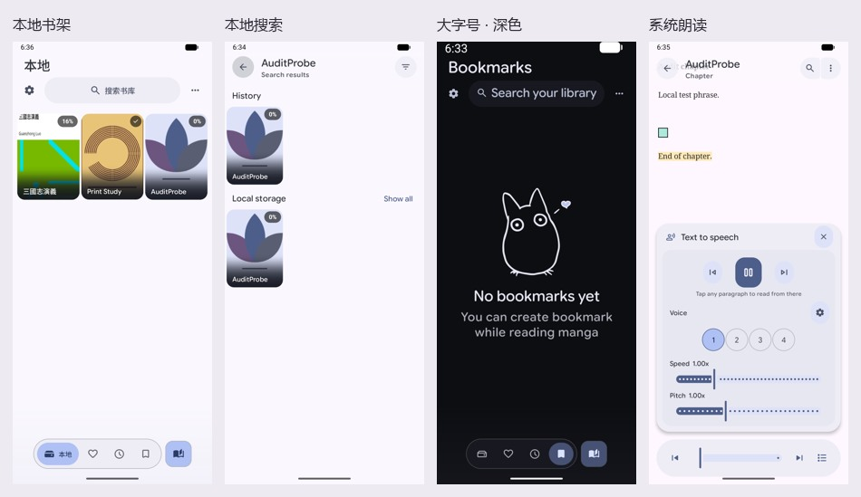
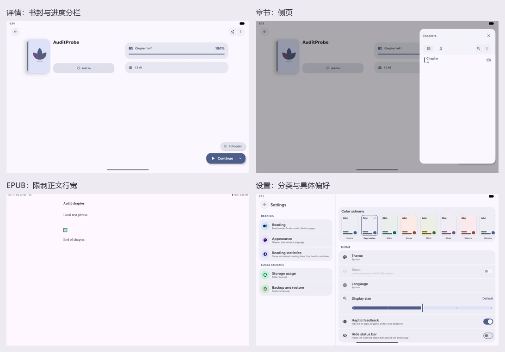

# DropSauce 离线阅读界面验收

代码候选：e07e1237（相对 6f410bda）。Preview，本地 R8 构建，API 37 x86_64 的 DropAudit AVD。手机像素 1080×2400、420 dpi；平板窗口为 2560×1600、320 dpi 覆盖值，不代表平板实机。

| 使用路径 | 审计发现与处理 |
|---|---|
| 书库、收藏、历史、书签 | 手机增加会随内容滚动的当前页标题；无封面时显示原创书封。删除收藏/历史里已过期的缩放公告及其状态订阅。空书库说明直接指向导入；空历史改为从书库开始阅读。保留鸟图在窗口中的固定锚点。 |
| 底栏 | 取消点击选中标签的延后交接。标签和指示器共用 150 ms 的节奏；宽度预算以当前窗口和翻译实测，优先保全触摸目标。保留拖动、重复选择与继续阅读。 |
| 导入、搜索、列表 | 手机、横屏及宽屏搜索框均指向本地书库。删除三份布局中已失效的更新气泡。列表展示纵向书封；搜索历史的补全和删除按钮至少 48 dp，分组标题允许两行。文件选择与导入解析沿用已有实现。 |
| 详情、章节 | 书封、标题及收藏和进度、简介、文件信息按可用宽度/字号重排。没有简介、评分、语言信息时省略空卡片。章节行随文案增高。订阅跟随生命周期，停止远程封面刷新，外部链接保留为文本。 |
| 漫画与 EPUB | 保留漫画缩放和翻页。EPUB 分页与渲染共用正文边距算法，大窗口保持阅读行宽。无封面不再暴露无效的点击操作。 |
| 标记、朗读 | 摘录与截图书签区分呈现；摘录行可随字号增高。朗读使用现有系统 TTS 和已安装离线音色，主播放按钮和前后跳句按钮形状有区分。 |
| 设置、统计、备份 | 阅读偏好与本地文件管理分组。宽屏统计图表与指标并排、排行另起一行；首次加载不显示空结果。备份与恢复沿用系统文件选择器。清理确认提示不再许诺可以重新下载。 |
| 隐私 | 未向详情或阅读器的系统助理上下文主动提交原始网址。最终 APK 没有 INTERNET 或 REQUEST_INSTALL_PACKAGES 权限；仍声明 ACCESS_NETWORK_STATE 和已有本地文件访问权限。 |

**覆盖边界。** 当前 APK 的合并清单包含 31 个 Activity，设置子页、底栏页和阅读面板另有 Fragment/Compose 实现。测试按用户可完成的任务组织，而非把每个清单类算作一项通过。沿用已有的文件解析、Room 数据层、备份格式、系统文件选择器、漫画分页和系统 TTS；没有为改版引入网络依赖或另建导航栈。

以下不计作本次运行通过：桌面小组件、系统生物识别、每种自定义手势、PDF/CBR 全格式回归、完整 TalkBack、所有语言、折叠屏铰链以及物理设备。历史版恢复或既有测试数据可能仍保有原始来源字段；不等于 APK 有权建立网络连接。本轮没有重新做全流量抓包。统计页英文单日计数仍沿用上游复数模板，可能显示 “1 active days”，不影响数值。

**中间轮次保留的失败。** 7c049335 在模拟器同时编译、切换窗口尺寸和冷启动时出现了一次前台无响应提示。系统事件明确指向本包 LocalStorageCleanupWorker 的 onStopJob 回调超时。主线程采样点为 HardwareRenderer.nSyncAndDrawFrame；RenderThread 在模拟器 EGL 的 qemu_pipe_read / glGetProgramiv，累计 runnable 调度等待约 10.55 秒；客体 CPU 压力 some avg10=75.85。堆栈没有指向清理代码持锁或在主线程读写文件。仅凭这一帧不能排除应用绘制负载，也不能断言生产设备不会复现。未通过禁用硬件加速、屏蔽系统作业或延长线程超时掩盖问题。

**构建与包检查（最终包）。** 本地 Gradle 离线执行 assemblePreview 和 testDebugUnitTest；204 项单测通过，失败/错误/跳过均为 0，lintVitalPreview 输出 No issues found。ZIP 完整性通过，合并清单中 59 个 Activity/Service/Receiver/Provider 的实现均能在最终 DEX 找到。包名 org.haziffe.dropsauce.preview，APK v2 签名验证通过，签名者为本机 Android Debug；这是可覆盖升级的内测包，不是长期发行签名。SHA-256：be11a5290ba1492f11cffee302a71a917bfdbcae86b0180c8162e9a3ce633e8e。

**可重复的验收步骤。**

1. 空书库，手机竖屏依次点本地、收藏、历史、书签。四次图案布局边界均为 [296,788] 至 [784,1276]，中心 Y=1032 px。清除历史筛选后检查本地阅读指引。
2. 有历史记录时在 1.8 倍系统字号、深色、关闭系统动画的条件下依次选择四页，点“继续阅读”。四个目的地实测各 133×122 px；继续阅读为 142×142 px。此前同一场景继续按钮曾被挤成一条窄边。
3. 从系统 Downloads 导入手工绘制的两页 CBZ 和公版《三國志演義》EPUB。检查实际书封、无封面占位、书名、漫画前后页；搜索已有书和无结果词，查验历史及本地结果。
4. 从历史的更多菜单进入统计，区分首次加载、空筛选与有本地时长/页数。设置中分别打开阅读和备份；在宽窗口打开书籍详情、章节侧页及 EPUB 正文，再切回手机。
5. 无活动默认网络时，打开 AuditProbe 的本地章节，通过阅读选项 → 工具 → 系统朗读，核对系统引擎事件。APK 哈希比对使用设备安装目录的 base.apk，而非根据文件名判断。

**最终包复测结果。** 空库四页插画边界、清除筛选后的历史指引、大字号底栏和继续阅读按钮、搜索命中与无结果、统计、设置与备份入口、平板详情/章节/EPUB、返回手机再次阅读和中文 EPUB 滚动均通过。无活动默认网络，系统引擎为本包 UID 10236 产生三条 eng-USA 的 tts_speak_success；未验证中文离线音色质量。重复前述平板→手机并重启阅读流程，未再观察到本包 ANR。最终 APK 与模拟器 base.apk 的 SHA-256 相同。测试结束恢复手机窗口和系统字号，停在简体中文书库。个别沿用的词条（例如继续阅读的无障碍名称）仍回退英文。

手机各图和平板前三图来自最终 APK；平板设置图为迭代中的结构验证，最终分组标题改为正常字形。未进行帧时间基准测试，也没有把布局尺寸、视觉偏好或模拟器现象外推为实机结论。
