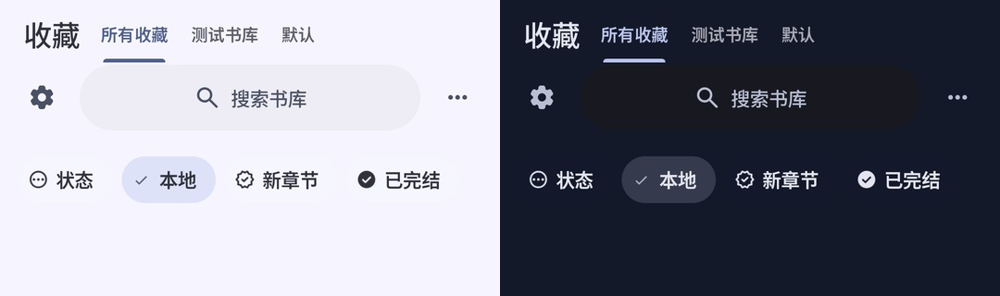

# Library heading and page tones

Preview 533df805, locally installed on DropAudit (API 37), November 9, 2026.

The left title and right category tabs share a reserved row. On entry the row becomes visible when the adapter has applied the first category list, including a confirmed empty list. Other destinations have no category-read dependency. User-defined names stay verbatim. The fallback name created for uncategorized Mihon imports uses the current language when created.

With the Expressive dynamic theme, both day and night page backgrounds use the system secondary palette; the current emulator seed produced page pixels #F6F5FF and #14192A. Header and body matched before and after a History round trip. The explicit black AMOLED theme retains its own background.

A temporary instrumentation observer opened MainActivity and selected Favorites through its navigation bar. It inspected every draw with a visible Favorites title for all three actual tab labels. The first such draw was complete in both locales: 0 incomplete out of 995 title draws in zh-CN and 0 out of 90 in en-US. The two sample shelf names were the same in both locales; the built-in tab read 所有收藏 or All favorites. These are draw observations, not a display frame-rate measurement.

All 204 unit tests passed, preview vital lint reported no issues, and the installed APK hash matched the local artifact. The APK lacks INTERNET permission. During separate cold-start and recording attempts, DropAudit reported input-focus ANRs; one captured stack showed the UI thread waiting in HWUI RenderProxy::setStopped and the render thread inside the emulator GLES encoder creating a GL program. Those recordings do not establish display timing, and cold-start reliability on this emulator is not signed off.
